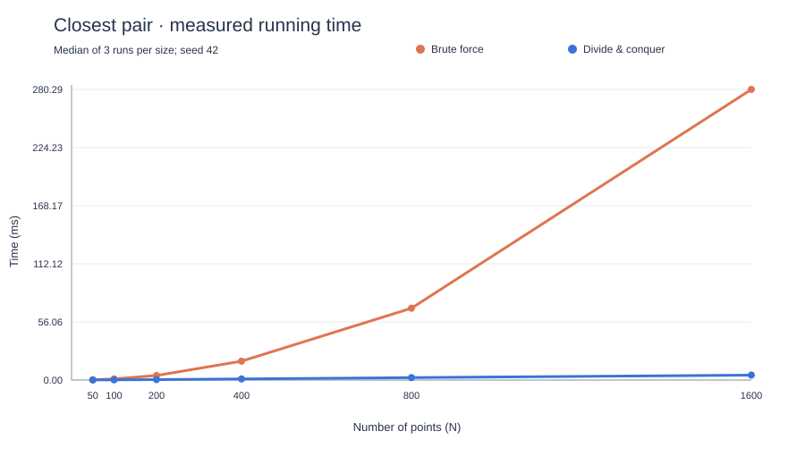

# Closest-pair performance analysis

Measured using Python 3.12 on the development machine, with uniform random floating-point coordinates, seed 42, and three runs per size. Values are medians in milliseconds. Point generation and animation recording were excluded; divide-and-conquer's initial sort was included. Both algorithms received identical points in every repetition.

| N | Brute force (ms) | Divide-and-conquer (ms) | Minimum distances agree |
| ---: | ---: | ---: | :---: |
| 50 | 0.272000 | 0.092834 | Yes |
| 100 | 1.103667 | 0.198000 | Yes |
| 200 | 4.400167 | 0.427625 | Yes |
| 400 | 18.208875 | 1.079709 | Yes |
| 800 | 69.296375 | 2.336250 | Yes |
| 1600 | 280.288292 | 4.766916 | Yes |

All **18 measured runs** agreed on the minimum distance.

Doubling N approximately quadrupled brute-force time, consistent with its N(N−1)/2 pair comparisons and O(N²) time. Divide-and-conquer grew more slowly, roughly doubling with some overhead, consistent with O(N log N).

At N = 1600, brute force checked **1,279,200 pairs**. Divide-and-conquer was about **58.8× faster** in this measurement. This ratio depends on the implementation, input distribution, machine, and system load. It is not a guaranteed speedup. Duplicates permit divide-and-conquer to stop after sorting and detecting a zero-distance pair; those datasets have a different timing profile.

The benchmark is reproducible from the command in the project README, but measured milliseconds will vary. The interactive app produces fresh measurements and verifies each repetition again.

